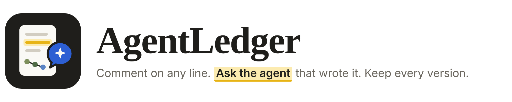
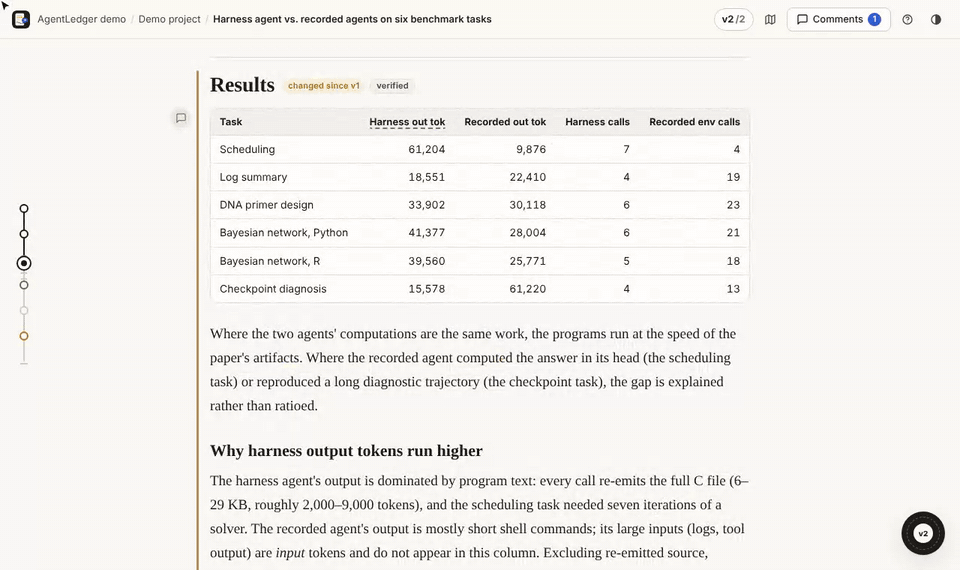
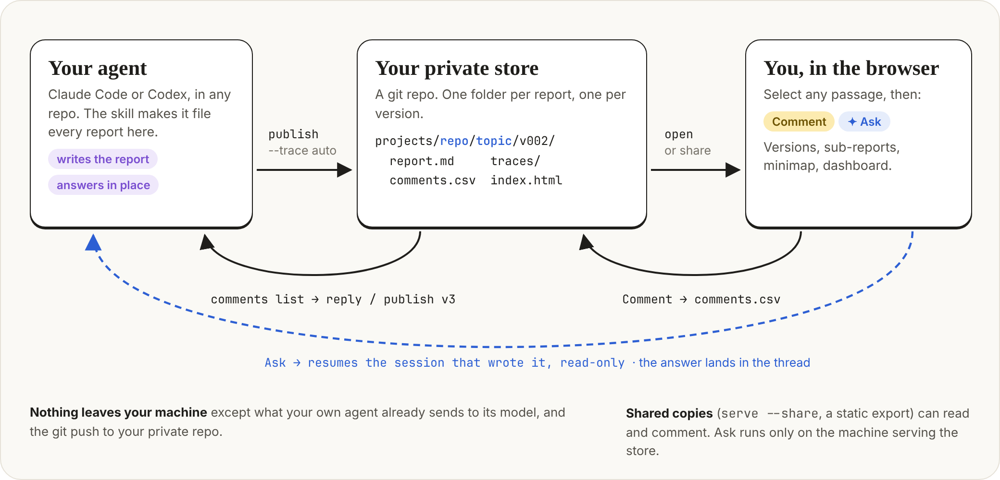
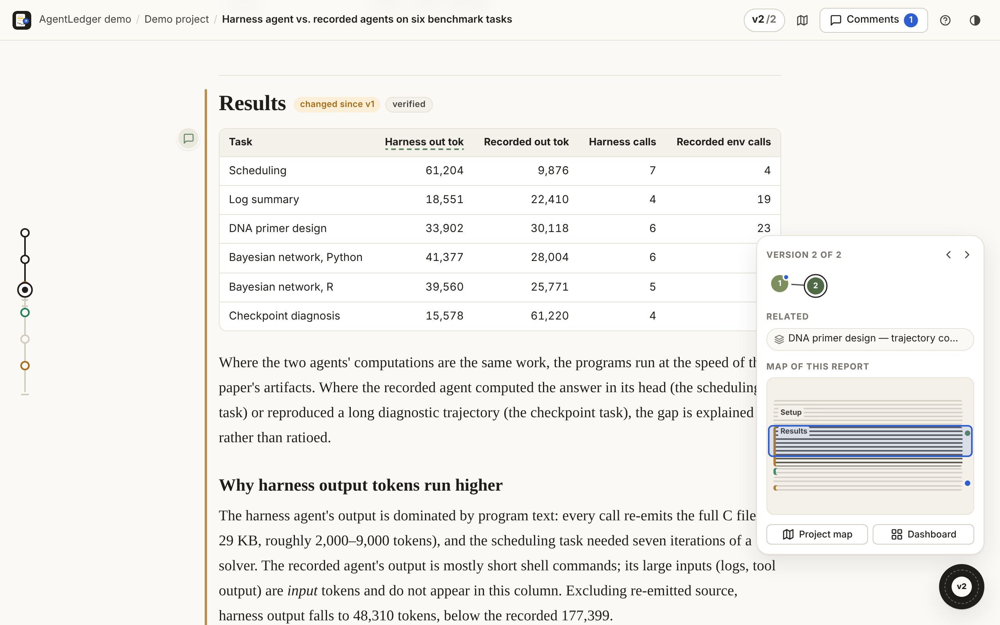
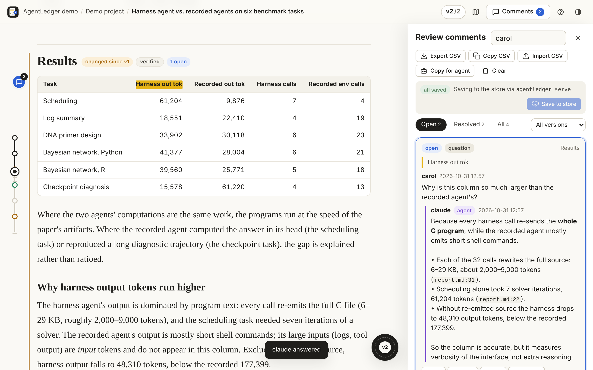
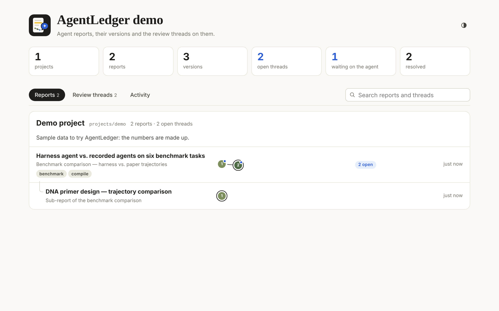
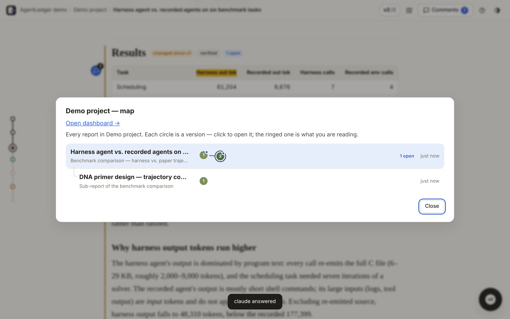

<p align="center">
  <picture>
    <source media="(prefers-color-scheme: dark)" srcset="docs/images/banner-dark.png">
    
  </picture>
</p>

<p align="center"><b>Filed by your agent. Reviewed by you. Answered by the session that wrote it.</b></p>

<p align="center">
  <a href="#quick-start">Quick start</a> ·
  <a href="#install">Install</a> ·
  <a href="#how-it-works">How it works</a> ·
  <a href="#reviewing">Reviewing</a> ·
  <a href="#guide">Guide</a> ·
  <a href="#reference">Reference</a>
</p>

<p align="center">
  
  
  
  
  
</p>

Agents now produce long write-ups: benchmark comparisons, audits, investigations. Reviewing them means scrolling a
wall of text, losing track of what changed between drafts, and asking follow-up questions in a chat that has long
forgotten how the numbers were made.

AgentLedger files every report your agent writes into **your own private git store**, renders it as a page you can
annotate, and sends your questions **back to the session that wrote it**, so the answer comes from the agent's memory
of the work and from its trace, not from a fresh guess.

<p align="center">
  <br>
  <sub>Select a passage → <b>Ask</b> → the agent that wrote the report answers in the thread. (Demo data.)</sub>
</p>

## Quick start

```sh
curl -fsSL https://raw.githubusercontent.com/SecretSettler/AgentLedger/main/install.sh | sh
```

That installs the CLI, creates a private store at `~/agentledger-store` (or links yours: `... | sh -s -- ~/my-store-clone`)
and installs the skill for **Claude Code** and **Codex**. Then, in any repository, just ask your agent:

> write this up as a report

and review it:

```sh
agentledger open        # http://localhost:8765, comment on any line, Ask about any passage
```

When you've commented, tell the agent *"handle the review comments on harness-vs-paper"*. It answers each thread,
publishes v2 with the fixes, and marks what it resolved.

Want to look around first? `agentledger demo` builds a sample store and opens it.

## Install

### 1. Let your agent do it

Paste this into Claude Code or Codex:

> Install AgentLedger from https://github.com/SecretSettler/AgentLedger: run
> `curl -fsSL https://raw.githubusercontent.com/SecretSettler/AgentLedger/main/install.sh | sh`
> (append `-s -- <path>` if I already have a store clone), make sure `agentledger` is on my PATH,
> then run `agentledger demo --no-open` and tell me the URL.

### 2. Claude Code plugin

```text
/plugin marketplace add SecretSettler/AgentLedger
/plugin install agentledger@agentledger
```

On Claude Code 2.1.275 or later, one step does both: `/plugin install agentledger --marketplace SecretSettler/AgentLedger`.
The plugin adds the skill plus `/agentledger:report`, `/agentledger:review` and `/agentledger:open`; on first use the
skill offers to install the CLI.

### 3. Codex

`install.sh` (or `agentledger setup`) places the skill in `~/.agents/skills/agentledger/`, where Codex picks it up.
Older Codex versions read `~/.codex/skills/`; copy [`skills/agentledger`](skills/agentledger) there.

### 4. By hand

```sh
pipx install git+https://github.com/SecretSettler/AgentLedger    # or: pip install --user ...
agentledger setup [path-to-your-store-clone]                      # creates ~/agentledger-store if you have none
```

**Keep the store private.** It holds your reports and the transcripts behind them. A new one is a local git repo; give
it a private remote, e.g. `gh repo create my-agent-ledger --private --source ~/agentledger-store --push`.

## How it works

<p align="center"></p>

1. **Publish.** The agent writes Markdown and runs `agentledger publish <repo>/<topic> draft.md --trace auto`. The CLI
   files it as the next version (`v001`, `v002`, …), records the repo, branch and commit it describes, attaches the
   transcript of the session that wrote it (gzipped), and remembers that session's id.
2. **Review.** `agentledger open` serves the store on `localhost` and opens the report. Every `##` section is a module
   you can comment on, link to and compare across versions.
3. **Comment.** Select any text and press **Comment**. Comments are saved into the version's `comments.csv`, through
   the local server, the GitHub API, or an exported CSV.
4. **Ask.** Select text and press **Ask**. Your question, the quote and the thread become the prompt. The session that
   wrote the report answers, read-only: Claude Code resumes a fork of it (`--resume --fork-session`, so your original
   session is untouched), Codex resumes it in place (`codex exec resume`). Each thread keeps its own continuation, so
   follow-ups remember the conversation. Without the session, a fresh read-only run answers from the trace.
5. **Revise.** The agent runs `agentledger comments list --status waiting`, replies in place, and publishes the next
   version with `--resolves`. Changed modules are flagged; resolved threads point at the version that fixed them.

Who can do what:

| | On the machine serving it (`agentledger open`) | Shared (`serve --share`, a static copy) |
|---|:---:|:---:|
| Read, navigate versions and sub-reports | ✓ | ✓ |
| Comment | ✓ | ✓ |
| Ask the agent | ✓ | |

A teammate with their own clone runs `agentledger open` on their machine and asks their own agent, which answers from
the report's traces (the original session only exists where it ran).

The store is a plain git repo with one fixed layout. Only the CLI writes into `projects/`, and `agentledger check`
flags anything out of place:

```
~/agentledger-store/
  agentledger.json, index.html (dashboard), manifest.json
  projects/<project>/<report>/
    v001/  report.md · meta.json · comments.csv · traces/ · index.html
    v002/
    <sub-report>/v001/ …
```

## Reviewing

<table>
  <tr>
    <td width="50%"></td>
    <td width="50%"></td>
  </tr>
  <tr>
    <td><b>Report.</b> Modules flagged <i>changed since v1</i>; the timeline rail on the left (drag its knob to scrub); the navigator pad with versions, sub-reports and a minimap.</td>
    <td><b>Review panel.</b> Threads anchored to the quoted text, agent answers inline, Export / Import / Copy CSV, <i>Copy for agent</i>.</td>
  </tr>
  <tr>
    <td></td>
    <td></td>
  </tr>
  <tr>
    <td><b>Dashboard.</b> Every project and report with its version chain, open threads, threads waiting on the agent, activity.</td>
    <td><b>Project map</b> (<kbd>m</kbd>). Every report in the project; each circle is a version.</td>
  </tr>
</table>

- **Comment / Ask:** select text, or use the icon on a module heading. Threads have go, reply, **Reply & ask**, resolve,
  edit and delete.
- **Navigate without scrolling:** the rail is the report as a vertical timeline; the round stick at the bottom right
  is a joystick (drag up or down to scroll, click to open the pad); the version chain opens any version at the same module.
- **Shortcuts:** <kbd>j</kbd>/<kbd>k</kbd> modules, <kbd>[</kbd>/<kbd>]</kbd> versions, <kbd>c</kbd> comment,
  <kbd>a</kbd> ask, <kbd>p</kbd> panel, <kbd>m</kbd> map, <kbd>n</kbd> pad, <kbd>d</kbd> dashboard, <kbd>?</kbd> help.
- Dark mode follows your system (or the toggle in the top bar). Unsaved comments live in the browser until saved.

## Guide

### Writing reports

The skill tells the agent all of this; it's here for when you write one yourself (`agentledger template` prints a skeleton).

- `# Title` first; front matter `summary:` (the answer in one or two sentences), `about:`, `tags:`.
- One `##` per module with a stable id, `## Results {#results}`, so comments and change tracking follow it across
  versions. Flag modules for a human check with `## Results {#results status=needs-review}`.
- Evidence next to every claim. Images and data: `--asset <path>`; they carry over to later versions.
- Sub-reports: publish to a longer id, `agentledger publish repo/topic/part part.md`.
- Traces: `--trace auto` attaches the publishing session's transcript; `--trace <path>` attaches any log or folder.

### Asking

- `agentledger open` (or `serve`) enables Ask when `claude` or `codex` is installed. The report's own session is used
  when its transcript is on this machine; otherwise `--ask claude|codex` picks the agent, and `--ask-cmd "<cmd>"` plugs
  in anything that reads a prompt on stdin and prints an answer.
- From the terminal: `agentledger ask <comment-id>`. `--print-prompt` shows exactly what the agent receives.
- Answers are saved as agent replies in `comments.csv`, so they are versioned with the report.

### Sharing

- **Same network:** `agentledger serve --share` lets teammates read and comment at `http://<your-ip>:8765`.
- **Remote machine:** `ssh -L 8765:localhost:8765 <host>`, then open `http://localhost:8765` (Ask works through the tunnel).
- **Through GitHub:** teammates clone the private store and run `agentledger open`; their comments come back with
  `agentledger sync`. Pages opened from disk can also **Save to GitHub** with a fine-grained token (Contents: read and
  write), or **Export CSV** for `agentledger comments import`.

### Privacy and security

- Nothing goes anywhere but your own repo. Pages load no external scripts, fonts or images. The only network call a
  page makes is Save to GitHub; Ask runs your own agent CLI, which sends what it reads to its model provider as usual.
- Ask is read-only (Claude Code with only Read/Grep/Glob; Codex with `--sandbox read-only`) and only served to requests
  from the machine itself; `--share` exposes reading and commenting, never Ask. Shared mode accepts IP addresses and this
  machine's names only, which blocks DNS rebinding.
- Report HTML passes an allow-list sanitiser (no scripts, handlers, frames, forms or `javascript:` URLs); `--allow-scripts`
  skips it for reports you fully trust.
- Don't publish a store through githack or GitHub Pages: both make the files public.

## Reference

| Command | |
|---|---|
| `agentledger` | Where your store is, what is waiting on you, what to run next |
| `setup [path]` | One-time setup: link or create the store; install the skill for Claude Code and Codex |
| `open [report-id]` | Serve on this machine and open the dashboard or a report (`--share`, `--ask`, `--port`) |
| `demo` | Build a sample store and open it (`--ask claude` to try a real agent) |
| `publish <id> <file\|folder>` | New report or new version (`--trace auto\|PATH --summary --about --changes --resolves --asset --tag`) |
| `sync [-m msg]` | Pull, rebuild, commit and push the store |
| `ask <comment-id>` | Have the agent answer a thread (`--backend`, `--cmd`, `--print-prompt`) |
| `comments list [id]` | Threads for agents (`--status open\|waiting\|closed\|all`, `--format md\|json\|csv`) |
| `comments reply / add / resolve / reopen / wontfix` | Work threads from the CLI |
| `comments import <csv\|->` / `export` | Move threads between browser and store |
| `serve` | Like `open` without opening a browser |
| `tree`, `check`, `root` | List reports, validate the layout, print the store path |
| `draft <id> [-o file]` | Copy the latest source to edit |
| `template`, `set`, `project`, `path`, `build`, `init` | Skeleton, metadata, paths, rebuild, new empty store |

The store is `--store`, else `$AGENTLEDGER_STORE`, else the nearest `agentledger.json` above the current directory,
else the one `setup` remembered (`~/.config/agentledger/config.json`).

<details><summary>Comment CSV schema</summary>

One schema everywhere (browser export, `comments.csv`, CLI). Rows merge by `id`, newest `updated` wins; deletions are
tombstones.

| Column | |
|---|---|
| `id`, `reply_to` | thread or reply id; replies point at their thread |
| `report`, `version`, `module` | where it was opened |
| `kind` | question, issue, suggestion, note, praise |
| `quote`, `prefix`, `suffix` | the selected text and 40 characters either side, used to re-anchor it in later versions |
| `body`, `author`, `role` | the message; `role` is `human` or `agent` |
| `status`, `resolved_in` | `open`, `resolved`, `wontfix` or `deleted`; the version that resolved it |
| `created`, `updated` | ISO 8601 UTC |
</details>

## Development

```sh
git clone https://github.com/SecretSettler/AgentLedger && cd AgentLedger
pip install -e .
python -m unittest discover -s tests -v
agentledger demo
```

The CLI is plain Python with no dependencies; the pages are plain CSS and JS in `agentledger/assets/`, inlined into
every generated page, with no build step. `claude plugin validate .` checks the plugin manifests.

Apache-2.0.
